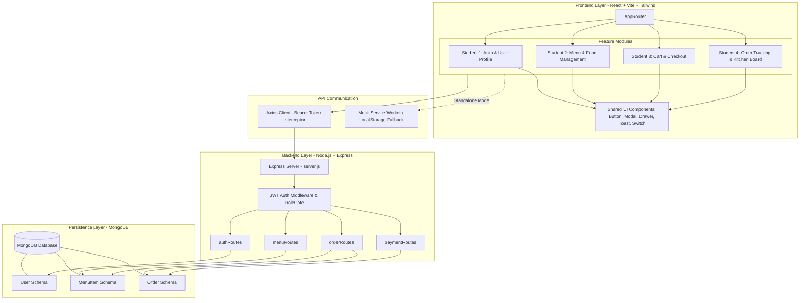
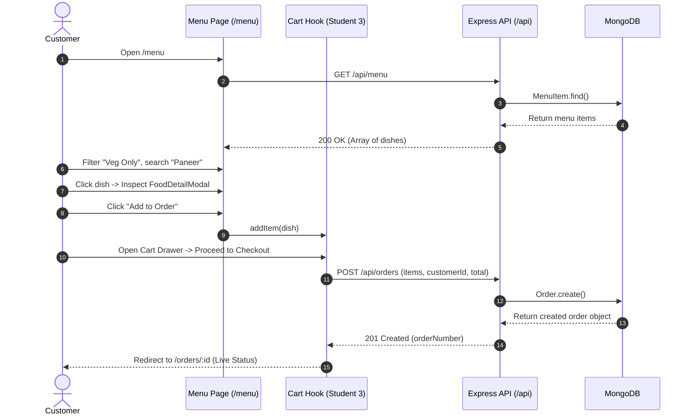
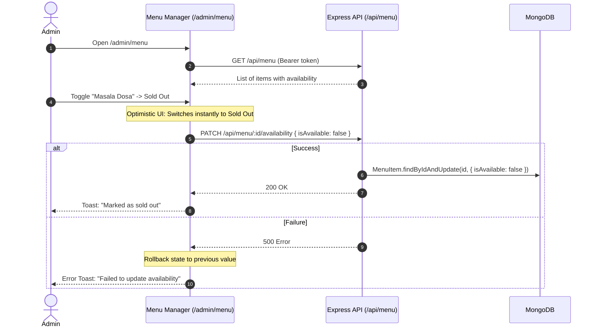

# System Architecture & Technical Specifications
## College Cafeteria Ordering System

**Repository:** `SDS-Group-5/cafeteria-ordering-system`  
**Authors & Team Collaboration:**  
- **Student 1:** Authentication & User Management  
- **Student 2 (Shreyash & Antigravity):** Menu & Food Management  
- **Student 3:** Cart & Order Placement  
- **Student 4:** Order Tracking & Admin Dashboard  
- **Backend Architecture & Data Layer:** Shantanu (Database & Schemas), Sarthak & Sherwin (Routes & Controllers)  

---

## 1. Executive Summary & Vision

The **College Cafeteria Ordering System** is a modern, high-performance web platform designed to streamline food ordering in college cafeterias. It replaces slow physical queues with a real-time digital catalog, self-service order placement, kitchen fulfillment boards, and live order tracking.

### Core Architectural Principles
1. **Feature-Driven Modular Frontend**: Each student's feature lives in an isolated feature folder (`client/src/features/<feature-name>/`) with its own state, components, and API client. They plug cleanly into the app without cross-feature merge conflicts.
2. **Layered Backend Architecture**: Clean separation between database schemas (`server/models/`), routing (`server/routes/`), business controllers (`server/controllers/`), and security middleware (`server/middleware/`).
3. **Decoupled API Contract & Mock Mode**: The frontend is fully functional both in standalone mock mode (`VITE_USE_MOCKS=true`) with persistent storage and simulated latency, and in connected full-stack mode (`VITE_USE_MOCKS=false`) against MongoDB and Express.

---

## 2. High-Level Architecture Diagram



---

## 3. Team Responsibilities & Ownership Matrix

| Feature Module | Student Owner | Frontend Scope (`client/src/`) | Backend Scope (`server/`) | Database Schema |
|---|---|---|---|---|
| **Auth & User Management** | **Student 1** | `features/auth/` (Login, Register, Profile, AuthContext) | `routes/authRoutes.js`, `middleware/auth.js` | `models/User.js` |
| **Menu & Food Management** | **Student 2 (Shreyash)** | `features/menu/` (Customer Menu, Filters, Admin Manager, Item Form, Availability Toggles) | `routes/menuRoutes.js` | `models/MenuItem.js` |
| **Cart & Order Placement** | **Student 3** | `features/cart/` (Cart drawer, Item quantities, Checkout, Razorpay) | `routes/orderRoutes.js` (POST), `routes/paymentRoutes.js` | `models/Order.js` (creation) |
| **Order Tracking & Admin Board** | **Student 4** | `features/orders/` (Order History, Live Status, Staff Kitchen Board, Stats Dashboard) | `routes/orderRoutes.js` (GET, PATCH status) | `models/Order.js` (state machine) |
| **Database & Seeder** | **Shantanu** | — | `config/db.js`, `models/*`, `utils/seed.js` | All Collections |
| **Routing & Controllers** | **Sarthak & Sherwin** | — | `routes/*`, `controllers/*` | API Endpoints |

---

## 4. Repository & File Organization

```
cafeteria-ordering-system/
├── .gitignore                      # Universal git ignore for root, client, and server
├── README.md                       # Group project overview, installation, and run guide
├── ARCHITECTURE.md                 # Complete system design & architecture documentation
│
├── client/                         # FRONTEND (React 18 + Vite + Tailwind CSS)
│   ├── .env.example                # Sample frontend configuration
│   ├── .env                        # Active config: VITE_API_URL, VITE_USE_MOCKS
│   ├── index.html                  # HTML entry point with Google Fonts (Bricolage Grotesque, Plus Jakarta Sans, JetBrains Mono)
│   ├── package.json                # Frontend dependencies
│   ├── postcss.config.js           # PostCSS Tailwind config
│   ├── tailwind.config.js          # Design system theme tokens (warm palette, shadows, radii)
│   ├── vite.config.js              # Vite bundler configuration with @ alias
│   └── src/
│       ├── main.jsx                # React DOM root render
│       ├── App.jsx                 # App shell mounting ToastProvider, DevRoleSwitcher, Router
│       ├── api/
│       │   └── axiosClient.js      # Global Axios instance with JWT bearer token interceptor
│       ├── components/
│       │   └── ui/                 # Atomic reusable UI primitives
│       │       ├── Badge.jsx       # Pill badge for tags and statuses
│       │       ├── Button.jsx      # Tactile button with variants & loading state
│       │       ├── ConfirmDialog.jsx # Explicit destructive action dialog
│       │       ├── Drawer.jsx      # Accessible slide-over right panel
│       │       ├── Input.jsx       # Form input with prefix/suffix & validation styling
│       │       ├── Modal.jsx       # Accessible modal dialog with scroll containment
│       │       ├── Select.jsx      # Styled dropdown select
│       │       ├── Skeleton.jsx    # Smooth pulse loading placeholder
│       │       ├── Switch.jsx      # Tactile toggle switch with sliding animation
│       │       └── Toast.jsx       # Notification queue & hook (useToast)
│       ├── routes/
│       │   └── AppRouter.jsx       # Central route registry (mounts feature routes)
│       ├── styles/
│       │   └── index.css           # Global typography, animations, dialog scroll isolation
│       ├── utils/
│       │   ├── constants.js        # API endpoints, roles, and default categories
│       │   └── formatCurrency.js   # Indian Rupee (₹) formatter via Intl.NumberFormat
│       └── features/
│           ├── auth/               # Student 1: Authentication views & state
│           ├── cart/               # Student 3: Cart state, Drawer, Checkout
│           ├── orders/             # Student 4: Order tracking & Kitchen dashboard
│           └── menu/               # Student 2 (Shreyash): Menu & Food Management
│               ├── README.md       # Feature documentation & API contract
│               ├── index.js        # Clean exports & route configurations
│               ├── api/
│               │   ├── menuApi.js  # Dispatches to Mock or Axios
│               │   └── mock/
│               │       ├── seedMenu.js # 20 authentic Indian cafeteria items
│               │       └── menuMock.js # LocalStorage + in-memory store with latency
│               ├── components/
│               │   ├── AvailabilitySwitch.jsx # Optimistic stock switch with rollback
│               │   ├── CategoryTabs.jsx       # Sticky horizontal scrolling category tabs
│               │   ├── DevRoleSwitcher.jsx    # Floating pill to flip Customer/Admin
│               │   ├── FoodCard.jsx           # Clamped food card with price & Add button
│               │   ├── FoodCardSkeleton.jsx   # Card loading skeleton
│               │   ├── FoodDetailModal.jsx    # Detail dialog with full photo & description
│               │   ├── MenuFilters.jsx        # Search, veg/non-veg filter, sorting
│               │   ├── MenuGrid.jsx           # Card grid view for admin management
│               │   ├── MenuItemForm.jsx       # Drawer form with live image preview
│               │   ├── MenuSummaryChips.jsx   # Header metric chips (Total, In Stock, etc.)
│               │   ├── MenuTable.jsx          # Sortable table with bulk actions
│               │   ├── RoleGate.jsx           # Non-admin access barrier
│               │   └── VegIndicator.jsx       # Standard FSSAI veg/non-veg badge
│               ├── hooks/
│               │   ├── useCurrentUser.js      # Auth stub for role testing
│               │   ├── useMenu.js             # Menu queries, mutations, cache updates
│               │   └── useMenuFilters.js      # Debounced search & URL query sync
│               └── pages/
│                   ├── MenuPage.jsx           # Customer view (/menu)
│                   └── MenuManagerPage.jsx    # Admin view (/admin/menu)
│
└── server/                         # BACKEND (Node.js + Express + MongoDB)
    ├── .env.example                # Sample backend environment variables
    ├── package.json                # Backend dependencies (express, mongoose, jwt, cors, bcryptjs)
    ├── server.js                   # Express server bootstrap & route mounting
    ├── config/
    │   └── db.js                   # Shantanu: Mongoose MongoDB connection
    ├── middleware/
    │   └── auth.js                 # Student 1: JWT verify & role authorization
    ├── models/
    │   ├── User.js                 # Shantanu: Customer & Admin User schema
    │   ├── MenuItem.js             # Shantanu: Food Item schema (Student 2)
    │   └── Order.js                # Shantanu: Customer Order schema (Student 3 & 4)
    ├── routes/
    │   ├── authRoutes.js           # Student 1: Register, Login, Me
    │   ├── menuRoutes.js           # Sarthak & Sherwin: Menu CRUD & Availability
    │   ├── orderRoutes.js          # Sarthak & Sherwin: Place order, history, status
    │   └── paymentRoutes.js        # Sarthak: Payment verification
    └── utils/
        └── seed.js                 # Shantanu: Seed script for MongoDB
```

---

## 5. End-to-End User Journeys & Data Flows

### Journey A: Customer Food Ordering Flow


### Journey B: Admin Menu Management & Availability Toggle


---

## 6. Database Architecture & Data Models

### A. `MenuItem` Schema (`server/models/MenuItem.js`)
Owned by **Shantanu** | Consumed by **Student 2 (Shreyash)**, **Student 3**, and **Student 4**

```javascript
{
  _id: ObjectId,                     // Primary Key (MongoDB)
  name: { type: String, required: true, trim: true, minlength: 2, maxlength: 60 },
  category: { type: String, required: true, trim: true },
  price: { type: Number, required: true, min: 0.01 },
  description: { type: String, required: true, trim: true, maxlength: 200 },
  image: { type: String, default: '', trim: true },
  isVeg: { type: Boolean, required: true, default: true },
  isAvailable: { type: Boolean, required: true, default: true },
  createdAt: ISODate,
  updatedAt: ISODate
}
```
- **Indexes:** `{ name: 'text', description: 'text', category: 1 }` for search indexing.

### B. `User` Schema (`server/models/User.js`)
Owned by **Shantanu** | Consumed by **Student 1 (Auth)**

```javascript
{
  _id: ObjectId,
  name: { type: String, required: true, trim: true, minlength: 2 },
  email: { type: String, required: true, unique: true, lowercase: true, trim: true },
  password: { type: String, required: true, minlength: 6, select: false },
  role: { type: String, enum: ['customer', 'admin', 'staff'], default: 'customer' },
  phone: { type: String, trim: true },
  createdAt: ISODate,
  updatedAt: ISODate
}
```

### C. `Order` Schema (`server/models/Order.js`)
Owned by **Shantanu** | Consumed by **Student 3 (Cart/Checkout)** and **Student 4 (Dashboard/Tracking)**

```javascript
{
  _id: ObjectId,
  orderNumber: { type: String, unique: true, required: true }, // e.g. "ORD-8492"
  customer: { type: ObjectId, ref: 'User', required: true },
  items: [
    {
      menuItem: { type: ObjectId, ref: 'MenuItem', required: true },
      name: { type: String, required: true },
      price: { type: Number, required: true },
      quantity: { type: Number, required: true, min: 1 },
      subtotal: { type: Number, required: true }
    }
  ],
  totalAmount: { type: Number, required: true, min: 0 },
  status: { 
    type: String, 
    enum: ['pending', 'preparing', 'ready', 'completed', 'cancelled'], 
    default: 'pending' 
  },
  paymentStatus: { type: String, enum: ['pending', 'paid', 'failed'], default: 'pending' },
  paymentId: { type: String },
  specialInstructions: { type: String, maxlength: 250 },
  createdAt: ISODate,
  updatedAt: ISODate
}
```
- **Indexes:** `{ customer: 1, createdAt: -1 }`, `{ status: 1 }`.

---

## 7. RESTful API Contracts & Endpoints

### Base URL: `http://localhost:5000/api`

| Endpoint | Method | Access | Request Body | Response Body | Feature Owner |
|---|---|---|---|---|---|
| `/auth/register` | `POST` | Public | `{ name, email, password }` | `{ token, user }` | Student 1 |
| `/auth/login` | `POST` | Public | `{ email, password }` | `{ token, user }` | Student 1 |
| `/auth/me` | `GET` | Authenticated | None | `{ user }` | Student 1 |
| `/menu` | `GET` | Public | None | `Array<MenuItem>` | Student 2 |
| `/menu` | `POST` | Admin | `{ name, category, price, description, image, isVeg, isAvailable }` | Created `MenuItem` | Student 2 |
| `/menu/:id` | `PUT` | Admin | `{ name, category, price, description, image, isVeg, isAvailable }` | Updated `MenuItem` | Student 2 |
| `/menu/:id/availability` | `PATCH` | Admin | `{ isAvailable: boolean }` | Updated `MenuItem` | Student 2 |
| `/menu/:id` | `DELETE` | Admin | None | `{ success: true, id }` | Student 2 |
| `/orders` | `POST` | Customer | `{ items: [{ menuItem, quantity }], specialInstructions }` | Created `Order` | Student 3 |
| `/orders/my-orders` | `GET` | Customer | None | `Array<Order>` | Student 4 |
| `/orders/:id` | `GET` | Authenticated | None | Single `Order` object | Student 4 |
| `/orders` | `GET` | Staff / Admin | Query: `?status=pending` | `Array<Order>` (Kitchen Queue) | Student 4 |
| `/orders/:id/status` | `PATCH` | Staff / Admin | `{ status: string }` | Updated `Order` | Student 4 |
| `/payment/create-order` | `POST` | Customer | `{ amount }` | `{ orderId, key }` | Student 3 |
| `/payment/verify` | `POST` | Customer | `{ razorpay_payment_id, ... }` | `{ success: true }` | Student 3 |

---

## 8. Frontend Architecture & Design System

### Design Tokens
Defined in [tailwind.config.js](file:///Users/shreyash/Desktop/SDS-Group-5/client/tailwind.config.js) and [index.css](file:///Users/shreyash/Desktop/SDS-Group-5/client/src/styles/index.css):
- **Background**: Warm Cream `#FAF8F5` (`bg-cafe-bg`), Surface White `#FFFFFF` (`bg-cafe-surface`)
- **Text**: Rich Charcoal `#1C1917` (`text-cafe-text`), Warm Muted `#78716C` (`text-cafe-subtext`)
- **Brand Accent**: Appetising Chilli-Saffron `#EA580C` (`bg-brand-600`), Tint `#FFF7ED` (`bg-brand-50`)
- **Dietary Indicators**:
  - **Vegetarian**: Emerald Green `#16A34A` (FSSAI green square with circle dot)
  - **Non-Vegetarian**: Crimson Red `#DC2626` (FSSAI red square with circle dot)
- **Typography**:
  - Headings: `Bricolage Grotesque`
  - Body & Form Controls: `Plus Jakarta Sans`
  - Prices & Numbers: `JetBrains Mono` with `tabular-nums`

### Component & Integration Stubs
To ensure Student 2's feature is independent and effortlessly merges with teammates:

1. **Student 1 Auth Integration Stub**:
   - Location: [useCurrentUser.js](file:///Users/shreyash/Desktop/SDS-Group-5/client/src/features/menu/hooks/useCurrentUser.js)
   - Interface: Returns `{ user, role, isAdmin, setRole }`.
   - On Merge: Replace this hook with Student 1's `AuthContext` / `useAuth()`.
2. **Student 3 Cart Integration Stub**:
   - Location: [MenuPage.jsx](file:///Users/shreyash/Desktop/SDS-Group-5/client/src/features/menu/pages/MenuPage.jsx) (`handleAddToCart`)
   - Interface: Emits `onAdd(item)`.
   - On Merge: Call Student 3's `useCart().addItem(item)` inside `handleAddToCart`.
3. **Student 4 Dashboard Reuse**:
   - Student 4 can import UI primitives ([Badge](file:///Users/shreyash/Desktop/SDS-Group-5/client/src/components/ui/Badge.jsx), [Button](file:///Users/shreyash/Desktop/SDS-Group-5/client/src/components/ui/Button.jsx), [Modal](file:///Users/shreyash/Desktop/SDS-Group-5/client/src/components/ui/Modal.jsx), [Skeleton](file:///Users/shreyash/Desktop/SDS-Group-5/client/src/components/ui/Skeleton.jsx)) directly from `src/components/ui/` to guarantee visual consistency.

---

## 9. Development & Execution Modes

### Mode 1: Standalone Mock Mode (Default)
In `client/.env`:
```bash
VITE_USE_MOCKS=true
```
- Operates 100% offline without requiring Node.js backend or MongoDB.
- Seed data contains 20 realistic Indian dishes across Breakfast, Meals, Snacks, Beverages, and Desserts.
- Emulates 400–700ms network latency.
- State changes (creating dishes, editing prices, toggling availability, deleting) persist in `localStorage`.
- Includes a floating **Dev Role Switcher** pill on screen to instantly flip between Customer and Admin modes.

### Mode 2: Live Full Stack Integration
In `client/.env`:
```bash
VITE_API_URL=http://localhost:5000/api
VITE_USE_MOCKS=false
```
- Starts the Express backend: `cd server && npm run dev`.
- Seeds the database: `cd server && npm run seed`.
- Frontend makes direct HTTP Axios requests with JWT authentication headers.
