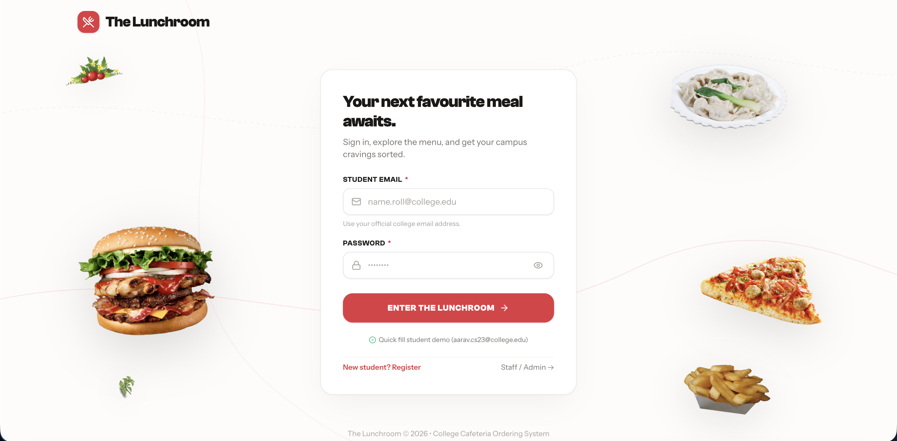
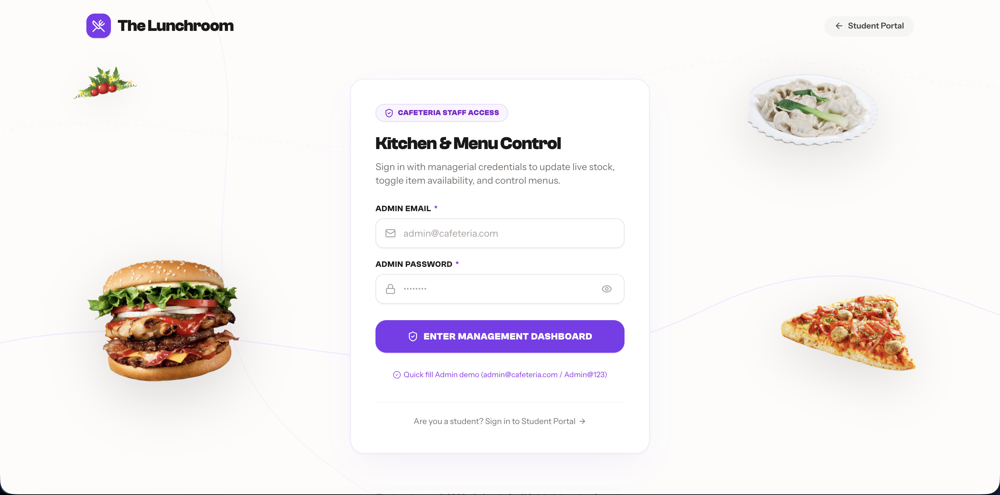
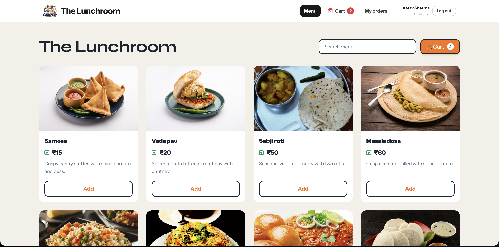
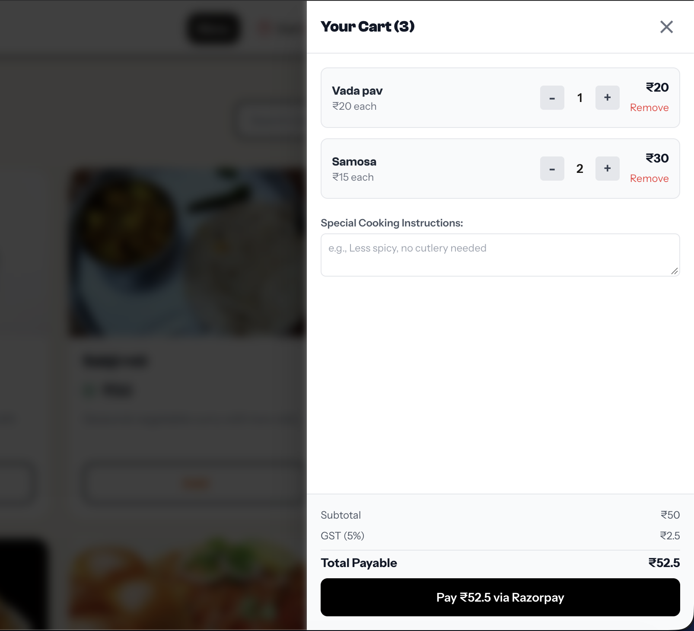
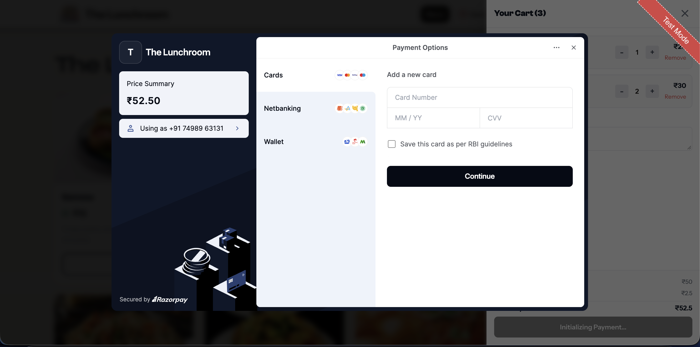
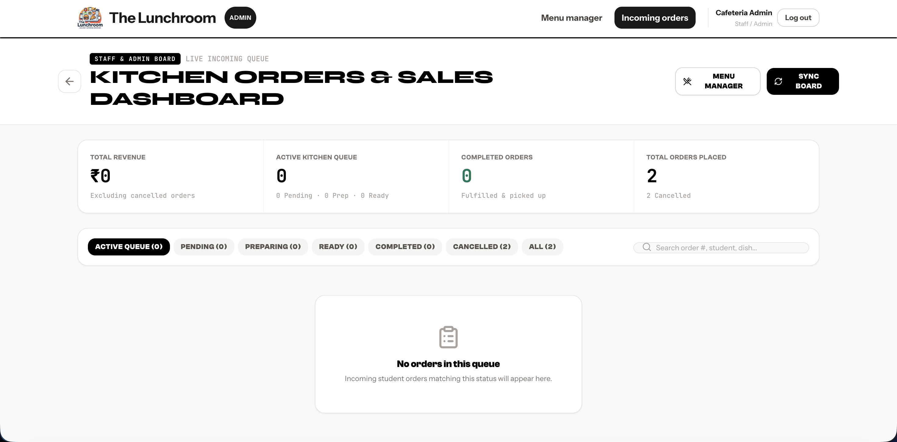
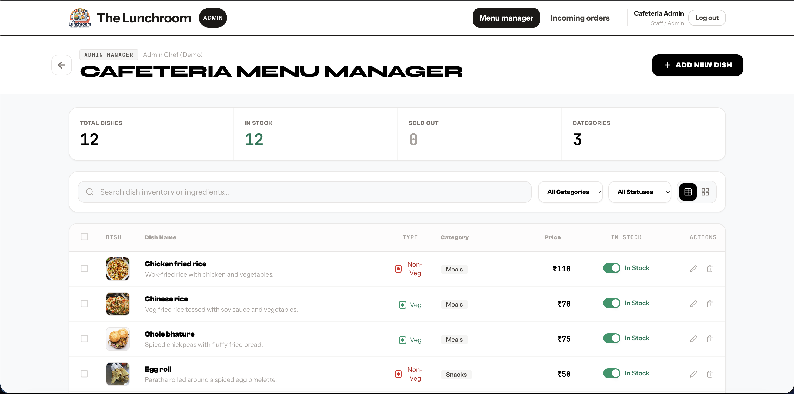
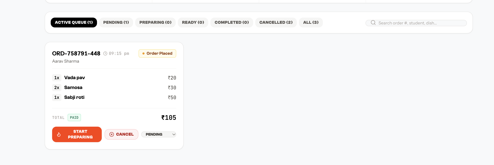

# The Lunchroom

Order lunch from your phone, skip the queue, and collect it when it's ready.


---

## What it is

**The Lunchroom** is a web platform that moves college cafeteria ordering online. Students browse the day's dishes, add what they want to a cart, pay through Razorpay, and follow the order from "received" to "picked up" without standing in a line.

Cafeteria staff get their own side of the site. They manage the menu, prices and stock availability, and see incoming orders as they arrive.

---

## Features

### For students
- Browse the menu with dish photos, prices, descriptions and vegetarian or non-vegetarian tags
- Filter dishes by dietary preference
- Add dishes to a cart that is kept when the page is refreshed
- Pay online with Razorpay (test mode)
- Track every order live through its stages: order received, preparing, ready at the counter, picked up
- See past orders and their payment status

### For cafeteria admins
- Add, edit and delete menu items
- Set prices and descriptions
- Mark dishes as available or sold out
- See incoming orders in a kitchen queue and update their status
- Sign in from a role-protected admin area

---

## A look inside

### Login

#### Student Login Portal


Students sign in with their college email (`aarav.cs23@college.edu`). New student accounts can also be created on the register page.

#### Admin Login Portal


Cafeteria staff and administrators access their dedicated management portal with role-based security.

### Menu


The full menu with photos, prices, vegetarian tags and an Add button on every dish.

### Cart


Change quantities, remove dishes and see the total before checking out.

### Checkout and payment


Payment goes through Razorpay. The server verifies every payment before an order is marked as paid.

### Order tracking


A live status tracker shows where the order is, with an itemised bill underneath.

### Admin menu manager


Add and edit dishes, and switch availability on or off in one tap.

### Admin orders


The kitchen queue of incoming orders, with controls to move each one to the next stage.

---

## Tech stack

| Area | Technology |
| :--- | :--- |
| Frontend framework | React 18 with Vite (single-page app) |
| Styling | Tailwind CSS |
| Routing | React Router v6 with role-based protected routes |
| State | React Context API (`AuthContext`, `CartContext`, `ToastContext`) |
| HTTP client | Axios, with a request interceptor that attaches the JWT |
| Icons | Lucide React |
| Backend | Node.js with Express |
| Database | MongoDB with Mongoose (MongoDB Atlas supported; embedded local MongoDB fallback for development) |
| Authentication | JSON Web Tokens, passwords hashed with bcryptjs |
| Payments | Razorpay Node SDK, with HMAC-SHA256 signature verification |
| Shared code | `shared/constants.js` holds roles, order statuses and menu limits for both sides |

---

## Demo accounts

These accounts are created by the seed script.

| Role | Email | Password | Where it leads |
| :--- | :--- | :--- | :--- |
| Student | `aarav.cs23@college.edu` | `lunchroom2026` | `/menu`, cart, checkout, `/orders` |
| Cafeteria admin | `admin@cafeteria.com` | `Admin@123` | `/admin/orders`, `/admin/menu` |

A cafeteria admin account can also be created on `/register` by choosing "Cafeteria Admin" and entering the admin security key `CAFE_ADMIN_2026`.

---

## Getting started

### 1. Install dependencies
```bash
npm run install:all
```

### 2. Create the environment files
Both examples are set up to run locally.
```bash
cp backend/.env.example backend/.env
cp frontend/.env.example frontend/.env
```

### 3. Seed the database
This adds the dishes and the demo accounts.
```bash
npm run seed --prefix backend
```

### 4. Run the app
Use two terminals.
```bash
# Terminal 1: backend API (http://localhost:5001)
npm run dev:server

# Terminal 2: frontend (http://localhost:5173)
npm run dev
```

Open **http://localhost:5173** in your browser.

---

## Project structure

```
The Lunchroom/
├── .gitignore
├── README.md                       # Project overview and quick start
├── ARCHITECTURE.md                 # System architecture, API contracts and schemas
├── INTEGRATION_NOTES.md            # Notes from combining the features into one project
├── package.json                    # Root scripts
├── docs/
│   └── screenshots/                # Images used in this README
├── shared/
│   └── constants.js                # Roles, order statuses and menu limits
├── frontend/                       # React and Tailwind frontend
│   ├── .env.example
│   ├── index.html
│   ├── package.json
│   ├── vite.config.js
│   ├── public/images/menu/         # Dish photos
│   └── src/
│       ├── App.jsx                 # App shell: providers, navbar, router
│       ├── components/
│       │   ├── Navbar.jsx          # Role-aware navigation
│       │   ├── ProtectedRoute.jsx  # Sign-in and role checks for routes
│       │   └── ui/                 # Button, Modal, Drawer, Toast, Badge
│       ├── context/                # AuthContext: session, login, register, token
│       ├── routes/AppRouter.jsx    # Public, student and admin routes
│       └── features/
│           ├── auth/               # Login, register and admin login pages
│           ├── menu/               # Student menu, admin menu manager, cards, forms
│           ├── cart/               # CartContext, CartDrawer, Razorpay checkout
│           └── orders/             # Student orders, order tracking, admin orders
└── backend/                        # Node.js and Express backend
    ├── .env.example
    ├── package.json
    ├── server.js                   # Server entry point (port 5001)
    ├── config/db.js                # MongoDB connection with local fallback
    ├── controllers/                # authController, menuController
    ├── middleware/auth.js          # JWT verification and role checks
    ├── models/                     # User, MenuItem, Order
    ├── routes/                     # authRoutes, menuRoutes, orderRoutes, paymentRoutes
    └── utils/seed.js               # Seeds dishes and demo accounts
```

---

## Documentation

- [ARCHITECTURE.md](ARCHITECTURE.md): how the system is put together, with data models and API contracts
- [INTEGRATION_NOTES.md](INTEGRATION_NOTES.md): what was combined into the project and what to watch for

---

## Status

Working in local testing:
- Account registration and login for students and cafeteria admins
- Menu browsing and admin menu management
- Cart, checkout and Razorpay payment in test mode (no real money is charged)
- Live order tracking for students and an order queue for admins

---

## About the project

Built for the Software Development Section (SDS), Group 5.
